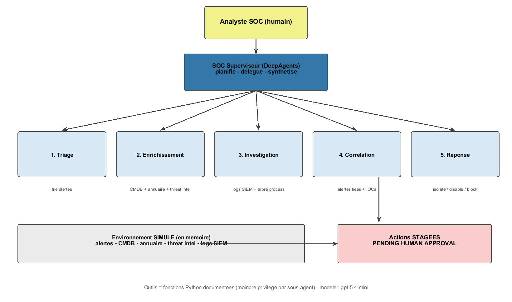
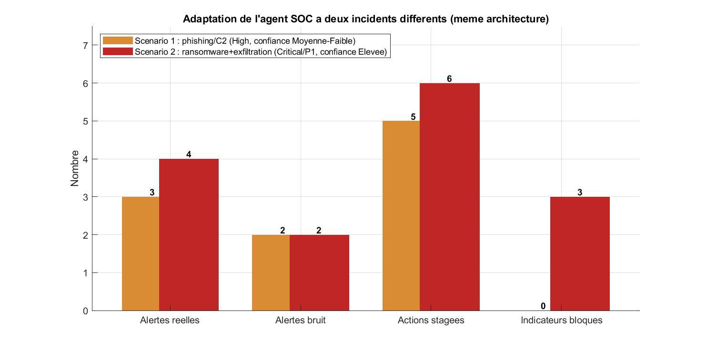
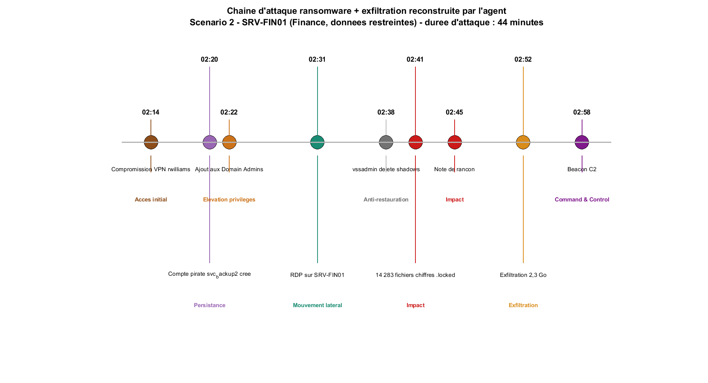
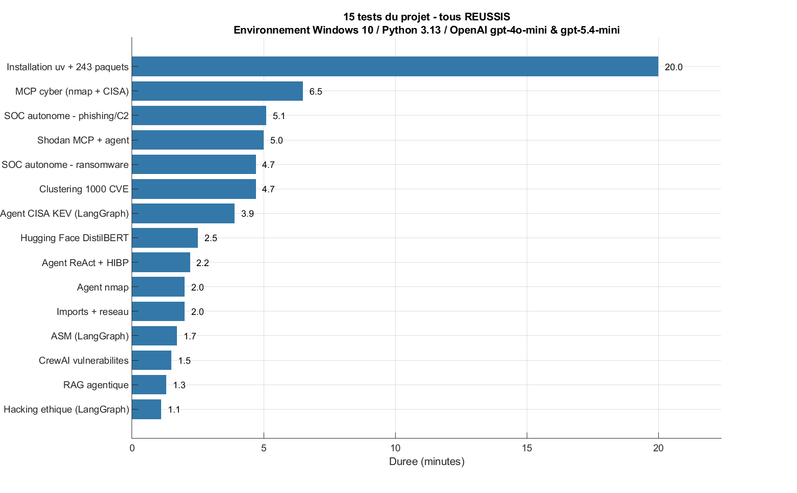

# SOC-AUTONOME-DEEPAGENTS
**Auteur : Jimmy SAMBIN** | Ingénieur, je conjugue systèmes d'information, cybersécurité, intelligence artificielle appliquée et opération technologique

---

## Un SOC autonome qui triage, enquête, corrèle et prépare la réponse

**SOC-AUTONOME-DEEPAGENTS** est un système d'agents IA autonomes appliqué aux
**opérations de sécurité (SOC)**. Là où un SOC classique noie ses analystes
sous les alertes, ce système orchestre **5 sous-agents spécialisés** qui
reproduisent le workflow d'un analyste : tri du bruit, enrichissement,
investigation, corrélation en un incident unique, puis **préparation de la
réponse** — chaque action restant soumise à **approbation humaine**.

> Testé sur deux incidents radicalement différents (phishing/C2 puis
> ransomware avec exfiltration de 2,3 Go) **sans modifier une ligne de
> logique** : seule la donnée change, l'agent adapte son diagnostic, sa
> sévérité et ses contre-mesures.

---

## Comment ça marche ?

Le système repose sur une architecture **superviseur + 5 sous-agents** (bibliothèque
DeepAgents). Le superviseur ne touche jamais les outils bruts : il **planifie**
l'enquête, **délègue** chaque phase à un spécialiste travaillant dans un contexte
propre (moindre privilege), puis **synthétise** le rapport final.

```
Analyste SOC (humain)
        │
        ▼
SOC Superviseur (DeepAgents) — planifie · délègue · synthétise
        │
        ├──> 1. TRIAGE          → file d'alertes        (escalate / suppress)
        ├──> 2. ENRICHISSEMENT  → CMDB + annuaire + threat intel
        ├──> 3. INVESTIGATION   → logs SIEM + arbre de processus (timeline, MITRE ATT&CK)
        ├──> 4. CORRÉLATION     → alertes liées + IOCs  (1 incident, pas N alertes)
        └──> 5. RÉPONSE         → isolate / disable / block  (STAGÉES)
                                        │
                                        ▼
                         Actions en attente d'APPROBATION HUMAINE
```

Chaque outil est une fonction documentée que le modèle lit pour décider quand
l'utiliser. Aucun outil n'est partagé entre sous-agents : **moindre privilege**.



---

## Explication synthétique — le livre du projet (Chapitre 7)

Le projet est la mise en pratique du **chapitre 7** du livre *Agentic AI for
Cybersecurity — Building Autonomous Defenders and Adversaries* (Omar Santos,
2026), indexé dans une base RAG locale (Qdrant) :

- **Le problème** : le fossé de vitesse entre attaquants et analystes humains.
  L'alert fatigue et l'économie du staffing rendent un SOC 100 % humain
  intenable → il faut un analyste autonome capable de détecter, analyser et
  répondre à la vitesse de la machine.
- **L'architecture préconisée** (4 couches) : **perception** (ingestion des
  télémétries), **raisonnement** (moteur LLM), **action** (orchestration de la
  réponse), **mémoire** (apprentissage continu).
- **La doctrine de sécurité** : séparer les phases **recommander / préparer /
  exécuter** avec des identités distinctes (RBAC, élévation just-in-time).
  Aucune action de containment ne s'exécute sans humain.
- **L'implémentation** : LangGraph (état, nœuds, arêtes conditionnelles) —
  transposé ici en DeepAgents avec sous-agents par phase.

---

## Résultats des tests

Le même système a été confronté à **deux incidents différents**, données seules changées :

| | Scénario 1 : Phishing → C2 | Scénario 2 : Ransomware + exfiltration |
|---|---|---|
| Alertes entrantes | 5 (3 réelles, 2 bruit) | 6 (4 réelles, 2 bruit) |
| Triage de l'agent | 3 escaladées, 2 supprimées ✅ | 4 escaladées, 2 supprimées ✅ |
| Incident corrélé | phishing → credential theft → lateral movement → C2 | VPN compromise → rogue admin → RDP → shadow copies deleted → mass encryption → exfiltration 2,3 Go → C2 beacon |
| Sévérité / Priorité | High / High | **Critical / P1 Immediate** |
| Confiance exprimée | **Medium-Low** (justifiée : logs absents) | **High** (logs riches) |
| Actions STAGÉES | 5 (isolate, disable, preserve evidence, review, hunt) | 6 (isolate, disable ×2, block ×3) |
| Durée | 5 min 08 | 4 min 41 |
| Coût LLM | < 0,05 $ | < 0,05 $ |

Points remarquables observés :
- **Jugement** : suppression correcte du bruit (maintenance, scan programmé) sans règle codée en dur
- **Nuance** : distinction compte *légitime compromis* (rwilliams) vs compte *pirate créé* (svc_backup2) — traités différemment
- **Honnêteté** : l'agent exprime l'incertitude au lieu de l'inventer
- **Récrits ransomware authentiques** : « valider les points de restauration avant remediation », « vérifier si les sauvegardes sont touchées »




---

## Structure du dépôt

```
SOC-AUTONOME-DEEPAGENTS/
|-- README.md
|-- .gitignore
|
|-- graphiques/
|   |-- architecture_soc.png          # Schema : superviseur + 5 sous-agents + approbation humaine
|   |-- comparaison_scenarios_soc.png # Les 2 incidents cote a cote (triage, actions, severite)
|   |-- chaine_attaque_ransomware.png # Timeline MITRE de la chaine d'attaque (reconstruite par l'agent)
|   |-- durees_tests_projet.png       # Les 15 tests du projet (tous reussis) et leur duree
|
|-- data/
|   |-- scenario1_phishing_c2.json            # Dataset du scenario 1 (alertes, CMDB, annuaire, threat intel, logs)
|   |-- scenario2_ransomware_exfiltration.json # Dataset du scenario 2 (meme structure)
|   |-- description_dataset.txt               # Description detaillee des champs
|   |-- resultats_tests.csv                   # Durees et statuts des 15 tests
|
|-- rapports/
|   |-- rapport_test_soc_autonome.txt          # Rapport complet du test scenario 1 + analyse
|   |-- rapport_test_soc_variante_ransomware.txt # Rapport du test scenario 2 + analyse d'adaptation
|
|-- scripts_matlab/
    |-- generer_graphiques.m                   # Generation des 4 graphiques (MATLAB R2024a, batch)
    |-- matlab_run.log
```

---

## Données (base data)

Les datasets `.json` décrivent intégralement les environnements SOC simulés :

- `alert_queue` — la file d'alertes (id, sévérité, source, IOCs)
- `asset_inventory` — la CMDB (criticité, classification des données)
- `user_directory` — l'annuaire (privilèges, MFA, événements récents)
- `threat_intel` — la réputation des indicateurs (verdict, confiance 0-100)
- `siem_logs` — les logs SIEM/EDR horodatés (reconstruction de timeline)
- `resultat_agent` — le résultat observé : triage, sévérité, confiance, actions STAGÉES

**Point de conception** : le même système d'agents est testé sur deux incidents
radicalement différents en changeant uniquement la donnée — les résultats
prouvent que la valeur est dans **l'architecture**, pas dans un scénario codé en dur.

---

## Technologies

* **Orchestration d'agents** : DeepAgents (superviseur + sous-agents, mémoire virtuelle)
* **Modèle LLM** : OpenAI gpt-5.4-mini
* **Environnement de test** : SOC 100 % simulé en mémoire (aucun système réel)
* **Base de connaissances** : RAG Qdrant (livre du projet indexé, embeddings 1536 d)
* **Visualisation** : MATLAB R2024a (batch, export PNG 150 dpi)
* **Doctrine de référence** : Omar Santos, *Agentic AI for Cybersecurity*, ch. 7

## Tests du projet global



15 tests exécutés et validés sur l'environnement complet (agents ReAct, RAG
agentique, serveurs MCP nmap/CISA/Shodan, CrewAI, LangGraph CISA-KEV /
hacking éthique / ASM, SOC autonome ×2) — **100 % de réussite**.

## Crédits

* **Code de référence** : [santosomar/AI-agents-for-cybersecurity](https://github.com/santosomar/AI-agents-for-cybersecurity) (Omar Santos, Cisco / O'Reilly)
* **Livre** : *Agentic AI for Cybersecurity — Building Autonomous Defenders and Adversaries*, Omar Santos
* **Portfolio** : [github.com/jimmy-sambin](https://github.com/jimmy-sambin)

## Roadmap

- [ ] Brancher le dataset simulé sur un export réel (SIEM/EDR type Sysmon)
- [ ] Ajouter un 3e scénario : insider threat / fraude au virement (Business Email Compromise)
- [ ] Mémoire persistante entre incidents (apprentissage continu — couche 4 du livre)
- [ ] Interface Streamlit de supervision des phases

## Licence

Projet open source — usage libre pour la formation et la recherche en
opérations de sécurité. **Rappel** : tout déploiement réel exige autorisation
écrite, supervision humaine et respect des lois applicables.
